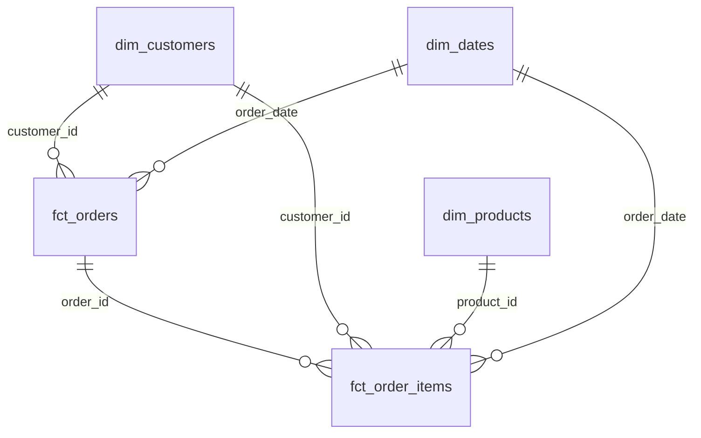
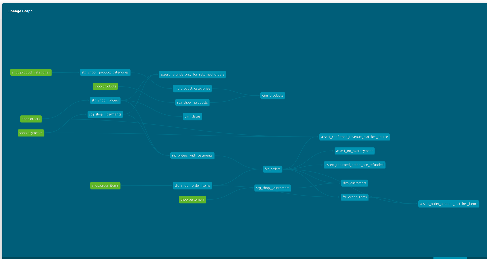

# Витрины интернет-магазина

## Модель данных


| Витрина | Одна строка | Бизнес-вопрос |
|---|---|---|
| fct_orders | Нетестовый заказ | Каков средний чек по городам? |
| fct_order_items | Товар в нетестовом заказе | Какова выручка по месяцам и категориям? |
| dim_customers | Клиент, включая не купивших | Какова доля покупателей по каналам? |
| dim_products | Товар с иерархией | Какие бренды чаще возвращают? |
| dim_dates | День | Как изменяются продажи по месяцам и выходным? |

Для возвратов по брендам соединяем позиции с заказами и товарами,
отбираем order_status = 'returned'. Если считаем заказы, используем
count(distinct order_id), а не count(*) позиций.

## Метрики
Подтверждённая покупка: статус paid и хотя бы одна успешная оплата
без возврата. Выручка: order_amount, на уровне позиций — line_amount.
items_count — число разных товаров, не сумма quantity.
Первая покупка выбирается по ordered_at, затем order_id.
first_confirmed_at — время оформления этой покупки.

## Хранение в Greenplum
| Витрина | Распределение | Хранение и причина |
|---|---|---|
| fct_orders | order_id | Колоночное AO; отчётам нужна часть колонок. Ключ совпадает с raw.orders и raw.payments. |
| fct_order_items | order_id | Колоночное AO; JOIN с fct_orders по общему ключу не требует перераспределения по разным ключам. Совпадает с raw.order_items. |
| dim_customers | replicated | 40 строк: дешёвая копия справочника на сегментах для JOIN. При росте пересмотреть. |
| dim_products | replicated | 13 строк: маленькое измерение для JOIN по product_id. |
| dim_dates | replicated | 133 дня: маленький календарь для JOIN по дате. |

## Качество данных
Generic-тесты проверяют уникальность и заполнение ключей, связи фактов,
статусы и неотрицательные меры. Singular-тесты проверяют суммы позиций,
выручку по raw, полный возврат и переплату.
Известная проблема источника: заказ 113, два успешных списания по 200
при сумме заказа 200. Тест assert_no_overpayment имеет severity='warn'.
Данные не исправляем; выручка этого заказа остаётся 200.

## Дополнительное задание
Использован dbt_utils 1.3.0: generate_surrogate_key для пары
order_id / product_id в stg_shop__order_items. Установка: dbt deps.
Факты полностью пересобираются; инкрементальная модель не используется.

## Документация
```bash
docker compose run --rm dbt docs generate
docker compose run --rm --service-ports dbt docs serve --host 0.0.0.0 --port 8080 --no-browser
```
Открыть http://localhost:8080 и граф lineage.

